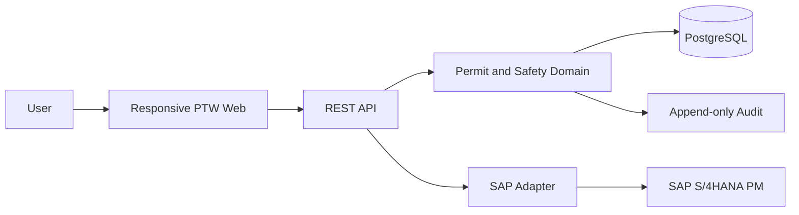

# Architecture

The PTW platform separates responsive field and operations experiences from the domain workflow,
REST API, PostgreSQL persistence, notifications, secure file storage, and SAP capability adapters.
Permit safety decisions do not depend on SAP availability.

