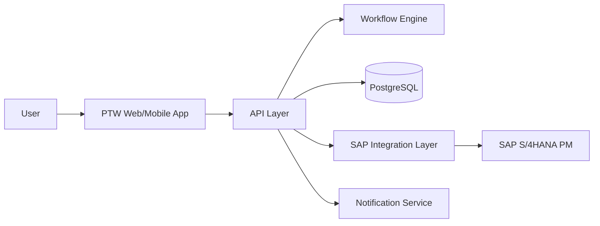

# Build an Enterprise Permit to Work (PTW) Application with SAP PM Integration

You are a senior enterprise application architect, full-stack developer, workflow architect, SAP integration specialist, and UX designer.

Design and implement a production-ready **Permit to Work (PTW) application** for an industrial/oil & gas environment. The application must manage the complete lifecycle of work permits and integrate with **SAP S/4HANA Plant Maintenance (SAP PM)**.

The application should be modular, secure, scalable, audit-ready, mobile-friendly, and suitable for enterprise deployment.

---

## 1. Business Objective

Build a digital Permit to Work application that allows authorized users to:

* Create work permits
* Reference SAP PM Maintenance Notifications and Work Orders
* Identify equipment and functional locations
* Perform work-risk assessment
* Define required isolations
* Define PPE and safety requirements
* Manage approvals
* Issue permits
* Monitor active permits
* Suspend permits
* Resume permits
* Extend permits where authorized
* Close permits
* Maintain a complete audit trail

The application should reduce manual paperwork and provide real-time visibility of work activities.

---

# 2. Technology Architecture

Use a modern enterprise architecture.

Recommended stack:

### Frontend

* React
* TypeScript
* Responsive UI
* Material UI or equivalent enterprise component library
* Mobile/tablet-friendly design

### Backend

* Node.js
* TypeScript
* REST APIs
* OpenAPI/Swagger documentation

### Database

Use PostgreSQL.

Design normalized tables with appropriate:

* Primary keys
* Foreign keys
* Indexes
* Unique constraints
* Audit fields

### Authentication

Implement enterprise authentication using:

* OAuth 2.0 / OpenID Connect
* Microsoft Entra ID/Azure AD compatible architecture

Support role-based access control.

### Integration

Implement an integration layer for SAP S/4HANA.

The design should support:

* SAP OData APIs
* REST APIs
* SAP Integration Suite
* Event-driven integration where appropriate

Do not hard-code SAP credentials.

All integration credentials must be stored securely using environment variables or enterprise secrets management.

---

# 3. User Roles

Implement role-based access control for at least these roles:

1. Permit Requester
2. Permit Issuer
3. Area Authority
4. Performing Authority
5. Maintenance Planner
6. Maintenance Supervisor
7. Safety Officer
8. Isolation Authority
9. Approver
10. Permit Administrator
11. SAP Integration Administrator
12. Read-Only/Auditor

Each role must have configurable permissions.

Example:

Requester:

* Create permit
* Save draft
* Submit permit
* View own permits

Issuer:

* Review permit
* Validate safety requirements
* Issue permit
* Suspend permit
* Close permit

Safety Officer:

* Review risk assessment
* Approve safety controls

Isolation Authority:

* Review isolation requirements
* Confirm isolation
* Release isolation

Administrator:

* Configure workflows
* Configure master data
* Manage users and roles
* View audit logs

---

# 4. Permit Types

Support configurable permit types.

Initial permit types:

* Cold Work Permit
* Hot Work Permit
* Confined Space Entry Permit
* Electrical Work Permit
* Excavation Permit
* Working at Height Permit
* Line Breaking Permit
* Radiation Work Permit
* Lifting Permit
* Vehicle Entry Permit
* General Maintenance Permit

Allow administrators to add new permit types without changing application code.

---

# 5. Permit Data Model

Create a comprehensive Permit entity.

Example fields:

Permit ID
Permit Type
Permit Status
Priority
Title
Description
Plant
Site
Area
Functional Location
Equipment
Maintenance Notification
Maintenance Order
Operation
Work Center
Requested By
Performing Organization
Performing Supervisor
Permit Issuer
Area Authority
Safety Officer
Isolation Authority
Planned Start Date/Time
Planned End Date/Time
Actual Start Date/Time
Actual End Date/Time
Risk Level
Risk Assessment
Emergency Contact
Number of Workers
Contractor
Work Description
Special Instructions
PPE Requirements
Hazards
Control Measures
Isolation Requirements
Attachments
Created Date
Created By
Modified Date
Modified By

---

# 6. Permit Lifecycle

Implement the following lifecycle:

DRAFT
→ SUBMITTED
→ UNDER_REVIEW
→ SAFETY_REVIEW
→ ISOLATION_PENDING
→ APPROVAL_PENDING
→ APPROVED
→ ISSUED
→ ACTIVE
→ SUSPENDED
→ RESUMED
→ EXTENSION_REQUESTED
→ EXPIRED
→ CLOSURE_PENDING
→ CLOSED
→ CANCELLED

The workflow must prevent invalid status transitions.

Create a configurable state machine.

Example:

DRAFT → SUBMITTED

SUBMITTED → UNDER_REVIEW

UNDER_REVIEW → SAFETY_REVIEW

SAFETY_REVIEW → ISOLATION_PENDING

ISOLATION_PENDING → APPROVAL_PENDING

APPROVAL_PENDING → APPROVED

APPROVED → ISSUED

ISSUED → ACTIVE

ACTIVE → SUSPENDED

SUSPENDED → RESUMED

ACTIVE → CLOSURE_PENDING

CLOSURE_PENDING → CLOSED

Allow authorized administrators to configure workflow rules.

---

# 7. Permit Creation Workflow

Create a guided wizard.

### Step 1 – Work Identification

Capture:

* Permit type
* Work description
* Plant
* Area
* Functional location
* Equipment
* Contractor
* Work crew

### Step 2 – SAP PM Reference

Allow the user to search and select:

* Maintenance Notification
* Maintenance Order
* Operation
* Functional Location
* Equipment
* Work Center

Retrieve data from SAP.

Display SAP information in read-only mode where appropriate.

Example:

SAP Order:
400012345

Description:
Pump Mechanical Seal Replacement

Equipment:
P-101

Functional Location:
PLANT01-PUMP-AREA1

Operation:
0020

Work Center:
MECH-01

---

# 8. Risk Assessment

Create a configurable risk assessment module.

Capture:

Hazard
Likelihood
Severity
Initial Risk
Control Measure
Residual Risk
Responsible Person

Provide a risk matrix.

Example:

Likelihood:
1 – Rare
2 – Unlikely
3 – Possible
4 – Likely
5 – Almost Certain

Severity:
1 – Minor
2 – Moderate
3 – Serious
4 – Major
5 – Catastrophic

Risk Score:

Likelihood × Severity

Configure risk categories:

1–4 = Low
5–9 = Medium
10–16 = High
17–25 = Critical

The application must require additional approval for High/Critical risks.

---

# 9. Safety Checklist

Create dynamic checklists based on permit type.

Example for Hot Work:

* Fire extinguisher available
* Gas test completed
* Combustible materials removed
* Fire watch assigned
* Area barricaded
* Emergency equipment available
* PPE verified
* Continuous gas monitoring required

The checklist should support:

YES
NO
N/A

Mandatory questions must be completed before submission.

---

# 10. Gas Testing

For applicable permits, create a gas testing section.

Capture:

Test Date/Time
Tester
Oxygen %
LEL %
H2S
CO
Other Gas
Instrument ID
Instrument Calibration Date
Result
Remarks

Support repeated gas tests during the permit lifecycle.

Generate warning when readings exceed configured thresholds.

---

# 11. Isolation Management

Create an isolation management module.

Isolation types:

* Electrical
* Mechanical
* Hydraulic
* Pneumatic
* Process
* Chemical
* Instrumentation

Capture:

Isolation Point
Equipment
Isolation Type
Lock Number
Tag Number
Isolation Status
Applied By
Verified By
Application Date/Time
Removal Date/Time

Statuses:

REQUESTED
PLANNED
APPLIED
VERIFIED
RELEASED

Support isolation certificates and approval.

---

# 12. Approval Workflow

Implement configurable multi-level approval.

Example:

Requester
↓
Maintenance Supervisor
↓
Area Authority
↓
Safety Officer
↓
Isolation Authority
↓
Permit Issuer

Approval requirements should depend on:

* Permit type
* Risk level
* Plant
* Area
* Work type
* Isolation requirement

Each approval must capture:

Approver
Decision
Comments
Date/Time

Decisions:

APPROVE
REJECT
SEND_BACK

---

# 13. Notifications

Implement notifications for:

* Permit submitted
* Approval required
* Permit approved
* Permit rejected
* Permit issued
* Permit expiring
* Permit expired
* Permit suspended
* Permit resumed
* Permit closure required

Support:

* Email
* In-app notifications
* Optional Microsoft Teams integration

Create configurable notification templates.

---

# 14. SAP PM Integration

Design a dedicated SAP integration service.

Create an abstraction layer:

SAPService
├── NotificationService
├── MaintenanceOrderService
├── EquipmentService
├── FunctionalLocationService
├── WorkCenterService
└── OperationService

Do not tightly couple business logic directly to SAP APIs.

---

# 15. SAP PM – Maintenance Notification

Support retrieving SAP PM notifications.

Example API abstraction:

GET /api/sap/notifications/{notificationNumber}

Return:

Notification Number
Description
Priority
Equipment
Functional Location
Plant
Planner Group
Created By
Created Date
Status

Allow users to search:

GET /api/sap/notifications?search=...

---

# 16. SAP PM – Maintenance Order

Support:

* Search maintenance orders
* Retrieve order details
* Retrieve operations
* Retrieve equipment
* Retrieve functional location
* Retrieve work center
* Display order status

Example:

GET /api/sap/orders/{orderNumber}

Return:

Order Number
Description
Order Type
Plant
Equipment
Functional Location
Main Work Center
Planner Group
System Status
User Status
Operations

---

# 17. SAP PM – Functional Location

Create:

GET /api/sap/functional-locations/{id}

Return:

Functional Location
Description
Plant
Location
Equipment
Criticality
Status

Provide autocomplete search.

---

# 18. SAP PM – Equipment

Create:

GET /api/sap/equipment/{id}

Return:

Equipment Number
Description
Equipment Category
Functional Location
Manufacturer
Model
Serial Number
Plant
Location
Status

---

# 19. SAP Integration Architecture

Design the integration as:

PTW Application
|
v
Integration/API Layer
|
+---- SAP Integration Suite
|
v
SAP S/4HANA PM

The system should support both synchronous and asynchronous integration.

For synchronous requests:

PTW → API Gateway → Integration Layer → SAP → Response

For asynchronous events:

SAP → Integration/Event Layer → PTW

Use correlation IDs for every integration transaction.

Log:

Correlation ID
Request ID
SAP Object
Request Timestamp
Response Timestamp
Status
Error Code
Error Message

Never store sensitive authentication tokens in application logs.

---

# 20. SAP-to-PTW Data Synchronization

Create configurable synchronization jobs.

Synchronize:

* Plants
* Work Centers
* Equipment
* Functional Locations
* Maintenance Notifications
* Maintenance Orders
* Operations
* SAP users where appropriate

Support:

* Initial load
* Incremental synchronization
* Retry mechanism
* Error queue
* Reprocessing

---

# 21. PTW-to-SAP Integration

Design optional outbound integration.

When a permit is created against a maintenance order, maintain the relationship:

SAP Maintenance Order
↕
PTW Permit

Possible outbound updates:

* Permit ID
* Permit status
* Permit issue date/time
* Permit closure date/time
* Safety status
* Work execution status

Do not update SAP objects unless the corresponding SAP API/business process explicitly supports the operation.

Make outbound updates configurable.

---

# 22. API Design

Create REST APIs such as:

POST /api/permits

GET /api/permits/{permitId}

PUT /api/permits/{permitId}

POST /api/permits/{permitId}/submit

POST /api/permits/{permitId}/approve

POST /api/permits/{permitId}/reject

POST /api/permits/{permitId}/issue

POST /api/permits/{permitId}/suspend

POST /api/permits/{permitId}/resume

POST /api/permits/{permitId}/extend

POST /api/permits/{permitId}/close

GET /api/permits/{permitId}/audit

GET /api/permits/{permitId}/workflow

GET /api/sap/orders

GET /api/sap/notifications

GET /api/sap/equipment

GET /api/sap/functional-locations

---

# 23. Dashboard

Create an enterprise dashboard showing:

Total Permits
Draft
Pending Approval
Approved
Active
Suspended
Expiring Soon
Expired
Closed
Cancelled

Provide filters:

Plant
Area
Permit Type
Risk Level
Status
Date
Contractor
Equipment
Maintenance Order

Create charts for:

Permits by status
Permits by type
Permits by risk level
Active permits by area
Permit aging
Permit closure trends

---

# 24. Permit Search

Implement powerful search.

Search by:

Permit Number
SAP Order
SAP Notification
Equipment
Functional Location
Plant
Area
Requester
Contractor
Permit Type
Status
Date Range

Support pagination, sorting and filtering.

---

# 25. Audit Trail

Every important action must be audited.

Capture:

User
Role
Action
Previous Value
New Value
Timestamp
IP/Session information where appropriate
Correlation ID

Examples:

Permit Created
Permit Submitted
Risk Changed
Approval Granted
Approval Rejected
Permit Issued
Permit Suspended
Permit Resumed
Permit Extended
Permit Closed

Audit records must be immutable from the application UI.

---

# 26. Attachments

Allow users to attach:

* JSA/JHA
* Risk Assessment
* Drawings
* Method Statements
* Isolation certificates
* Gas test certificates
* Photos
* Supporting documents

Store files securely.

Implement:

* File type validation
* File size limits
* Virus/malware scanning integration point
* Access control
* Download authorization
* Audit logging

---

# 27. QR Code

Generate a QR code for every active permit.

Example:

PTW-2026-000123

Scanning the QR code should open the permit verification screen.

The verification screen should show:

Permit Number
Permit Type
Work Description
Equipment
Location
Status
Valid From
Valid To
Issuer

Do not expose confidential information without authentication.

---

# 28. Mobile Design

The application must work well on:

Desktop
Tablet
Mobile

Mobile users should be able to:

* View permits
* Approve permits
* Perform checklist
* Record gas tests
* Verify isolations
* Suspend permits
* Resume permits
* Close permits
* Scan QR codes
* Upload photographs

---

# 29. Security

Implement enterprise security best practices.

Requirements:

* OAuth/OIDC
* RBAC
* API authorization
* Input validation
* SQL injection protection
* XSS protection
* CSRF protection where applicable
* Rate limiting
* Secure headers
* Encryption in transit
* Encryption at rest
* Secrets management
* Audit logging

Follow OWASP recommendations.

---

# 30. Error Handling

Create standardized error responses.

Example:

{
"errorCode": "SAP_INTEGRATION_ERROR",
"message": "Unable to retrieve maintenance order",
"correlationId": "abc-123",
"timestamp": "..."
}

Never expose internal stack traces to end users.

---

# 31. Offline Capability

For field/mobile usage, design an optional offline mode.

Allow users to temporarily access:

* Assigned permits
* Checklists
* Safety information
* Permit details

Queue transactions while offline and synchronize when connectivity returns.

Handle synchronization conflicts safely.

---

# 32. Reporting

Create reports:

* Daily Permit Report
* Active Permit Report
* Expired Permit Report
* High-Risk Permit Report
* Hot Work Report
* Confined Space Report
* Isolation Report
* Contractor Permit Report
* Permit Closure Report
* SAP Order vs Permit Report

Allow export to Excel/PDF where appropriate.

---

# 33. Configuration

Do not hard-code business rules.

Create configuration tables/modules for:

* Permit types
* Risk matrix
* Approval matrix
* Safety checklists
* PPE requirements
* Isolation types
* Gas test limits
* Plants
* Areas
* User roles
* Notification templates
* Permit validity periods

---

# 34. Database Design

Create a complete ERD and database migrations.

Minimum tables:

users
roles
permissions
user_roles
permits
permit_types
permit_status_history
permit_approvals
permit_checklists
permit_checklist_items
risk_assessments
hazards
risk_controls
gas_tests
isolations
isolation_points
attachments
notifications
audit_logs
sap_notifications
sap_orders
sap_operations
sap_equipment
sap_functional_locations
sap_work_centers
integration_logs
integration_errors
workflow_definitions
workflow_instances
workflow_tasks
configuration

Use UUIDs internally where appropriate while preserving SAP business object numbers.

---

# 35. Testing

Create:

### Unit Tests

* Business rules
* Risk calculations
* Workflow transitions
* Authorization
* SAP service layer

### Integration Tests

* SAP API integration
* Database
* Authentication
* Notification service

### End-to-End Tests

Example:

Create permit
→ Select SAP order
→ Perform risk assessment
→ Complete checklist
→ Request isolation
→ Approve
→ Issue
→ Activate
→ Suspend
→ Resume
→ Close

Test invalid transitions as well.

---

# 36. GitHub Copilot Development Approach

Work incrementally.

Do NOT generate the entire application in one file.

Create a clean repository structure:

/frontend
/backend
/database
/integration
/workflows
/tests
/docs
/infrastructure

Create reusable components and services.

Use TypeScript throughout.

Use environment-specific configuration:

.env.development
.env.test
.env.production

Never commit secrets.

---

# 37. Documentation

Generate:

README.md
ARCHITECTURE.md
API.md
DATABASE.md
SAP-INTEGRATION.md
WORKFLOW.md
SECURITY.md
DEPLOYMENT.md
TESTING.md

Include architecture diagrams using Mermaid.

Example:

---

# 38. Development Instructions for GitHub Copilot

When implementing this project:

1. First create the architecture.
2. Then create the database schema.
3. Then implement authentication and authorization.
4. Then implement the Permit APIs.
5. Then implement the workflow engine.
6. Then implement risk assessment.
7. Then implement checklist management.
8. Then implement isolation management.
9. Then implement SAP PM integration.
10. Then implement notifications.
11. Then implement the dashboard.
12. Then implement mobile responsiveness.
13. Then implement audit logging.
14. Then implement reporting.
15. Finally implement automated testing and deployment.

Before generating each major module:

* Explain the design briefly.
* Identify dependencies.
* Create interfaces first.
* Implement services.
* Implement APIs.
* Implement UI.
* Add tests.
* Update documentation.

Do not introduce unnecessary dependencies.

Follow SOLID principles, clean architecture, separation of concerns, secure coding practices, and enterprise coding standards.

---

# 39. Important SAP Requirement

Do not assume the exact SAP S/4HANA release or available APIs.

Create an SAP adapter/interface so that the application can support different SAP landscapes.

Example:

interface SAPMaintenanceOrderService {
searchOrders(criteria: SearchCriteria): Promise<MaintenanceOrder[]>;
getOrder(orderNumber: string): Promise<MaintenanceOrder>;
getOperations(orderNumber: string): Promise<Operation[]>;
}

Implement the SAP-specific adapter separately.

Document which SAP APIs/OData services need to be configured by the SAP team.

Do not fabricate SAP API endpoints.

---

# 40. Expected Final Deliverable

Generate a production-ready solution containing:

1. System architecture
2. Database schema
3. ERD
4. Backend APIs
5. Frontend application
6. Workflow engine
7. Risk assessment
8. Safety checklist
9. Gas testing
10. Isolation management
11. Approval workflow
12. Notifications
13. SAP PM integration layer
14. Dashboard
15. Audit trail
16. Reporting
17. Security
18. Automated tests
19. Deployment configuration
20. Complete technical documentation

The application should be designed as an enterprise-grade **digital Permit to Work platform integrated with SAP S/4HANA Plant Maintenance**, with configurable workflows and business rules rather than hard-coded processes.
