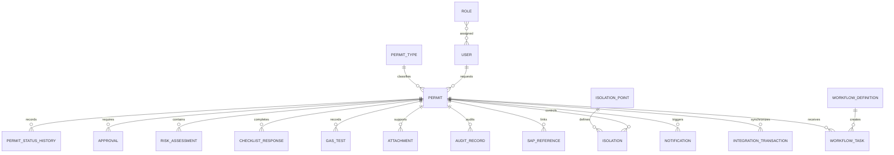

# Data Model: Enterprise Permit to Work Platform

## Modeling Conventions

- Internal records use UUID identifiers where appropriate.
- SAP business identifiers are retained as unique, searchable source keys and are never replaced by
  internal IDs.
- Records that affect safety or compliance carry created and modified timestamps and actor IDs.
- Audit and permit status history are append-only from the application interface.
- Configuration is versioned or effective-dated so that historical permits remain interpretable.

## Core Entities

### User

Represents an authenticated person and their operational scope.

- Fields: id, identity subject, display name, contact details, active state, created and updated
  timestamps.
- Relationships: many-to-many with Role; scoped to plants and areas; acts on permits, approvals,
  safety records, isolations, attachments, notifications, and audit entries.
- Validation: inactive users cannot perform new actions; identity subject is unique.

### Role and Permission

Configurable authorization vocabulary and assignment.

- Fields: role id, name, description, permissions, active state, effective dates.
- Relationships: users, workflow tasks, approval rules, plant or area scopes.
- Validation: permissions are explicit and deny-by-default outside assigned scope.

### Permit Type

Configures the controls and workflow behavior for a class of work.

- Fields: id, name, description, required controls, validity policy, active version, effective dates.
- Relationships: permits, checklists, approval rules, gas limits, PPE requirements, isolation rules.
- Validation: active permits retain the version used at creation or submission.

### Permit

The controlled authorization for work.

- Fields: id, permit number, type, status, priority, title, work description, site, plant, area,
  functional location, equipment, work organization, crew, contractor, responsible users, planned
  and actual times, risk summary, emergency contact, worker count, instructions, created and
  modified actor and timestamps.
- Relationships: one-to-many with status history, approvals, checklists, risk assessments, gas
  tests, isolations, attachments, notifications, and audit records; optional SAP references.
- Validation: required fields depend on permit type; planned end must follow planned start; only
  valid actors and transitions can change status.

### Permit Status History

Immutable record of each lifecycle transition or rejected material attempt where policy requires it.

- Fields: id, permit id, from status, to status, action, actor, reason, correlation id, timestamp.
- Relationships: belongs to permit and actor.
- Validation: accepted transitions must match the active workflow definition.

### Workflow Definition and Task

Configurable state transition and responsibility model.

- Definition fields: id, version, scope criteria, states, transitions, prerequisites, effective
  dates, active state.
- Task fields: id, permit id, definition version, step, assigned role or user, status, decision,
  due time, completed time.
- Validation: definitions cannot remove the historical meaning of an already-used version.

### Risk Assessment, Hazard, and Risk Control

Structured hazard evaluation for a permit.

- Fields: assessment id, permit id, hazard, likelihood, severity, initial score and category,
  control, residual likelihood and severity, residual score and category, responsible user,
  assessment version, timestamps.
- Validation: scores are calculated as likelihood multiplied by severity using the effective matrix;
  high and critical residual risk triggers configured approval.

### Safety Checklist and Checklist Response

Permit-type-specific safety questions and evidence.

- Definition fields: checklist id, permit type, version, question, mandatory flag, response options,
  ordering, effective dates.
- Response fields: permit id, checklist item id, response, comment, actor, timestamp, evidence.
- Validation: every mandatory item must have an allowed response before the configured gate.

### Gas Test

A repeated measurement associated with a permit and validity period.

- Fields: id, permit id, tester, test time, oxygen, LEL, H2S, CO, other gas, instrument id,
  calibration date, result, threshold evaluation, remarks, timestamps.
- Validation: numeric readings and units are validated; uncalibrated or over-threshold results
  cannot count as a passing test without an explicit authorized disposition.

### Isolation and Isolation Point

A control that prevents hazardous energy or material release.

- Point fields: id, equipment, location, isolation type, active state.
- Isolation fields: id, permit id, point id, lock number, tag number, status, applied and verified
  actors, application and removal times, certificate reference, comments.
- Validation: status movement is constrained to REQUESTED, PLANNED, APPLIED, VERIFIED, and RELEASED;
  issue requires every required isolation to be VERIFIED.

### Approval

A decision in the configured approval chain.

- Fields: id, permit id, workflow task, required role, approver, decision, comments, decision time.
- Validation: only the assigned or validly delegated approver can decide; approval decisions are
  immutable and later corrections are compensating records.

### Attachment

Protected evidence or supporting file.

- Fields: id, permit id, category, original name, content reference, size, media type, uploader,
  scan state, access policy, created time.
- Validation: allowlisted file type and size; quarantined or rejected files cannot be downloaded;
  download access is authorized and audited.

### Notification

A delivery record for a lifecycle or operational event.

- Fields: id, recipient, permit id, event, channel, template version, state, sent and read times,
  failure details, correlation id.
- Validation: delivery failure does not bypass a safety gate; retries are bounded and observable.

### Audit Record

Append-only evidence of a material action.

- Fields: id, actor, role, action, entity type and id, previous values, new values, timestamp,
  session or IP metadata where allowed, correlation id.
- Validation: application users cannot edit or delete records; sensitive values are redacted.

### SAP Maintenance Reference

A link and source snapshot for notification, order, operation, equipment, functional location, or
work center data.

- Fields: id, permit id, object type, SAP business identifier, source description and attributes,
  source status, retrieved time, source version or ETag where available, synchronization state.
- Validation: source attributes are read-only by default; unavailable source data does not erase
  the permit relationship or audit history.

### Integration Transaction and Error

Operational record for synchronous requests and asynchronous synchronization.

- Fields: id, correlation id, request id, object type and identifier, direction, operation, request
  and response times, status, error code and sanitized message, retry count, next retry, resolution.
- Validation: credentials and tokens are excluded; failed records can be retried or reprocessed by
  authorized integration administrators.

### Configuration and Master Data

Effective-dated values for plants, areas, risk matrices, gas limits, PPE, validity periods,
notification templates, approval rules, and offline policies.

- Validation: configuration changes are authorized, audited, versioned, and cannot silently change
  the interpretation of historical permit decisions.

## Relationship Summary

## Lifecycle Invariants

- A permit has exactly one current status and an append-only status history.
- A permit cannot enter approval or issue gates while mandatory safety controls are incomplete.
- High and critical residual risks require configured additional approval.
- A permit cannot be issued while required isolations are not verified.
- A closed, cancelled, or expired permit cannot resume or be extended unless a configured exception
  explicitly permits it and the exception is audited.
- Every accepted lifecycle action has an actor, timestamp, resulting status, and correlation ID.
