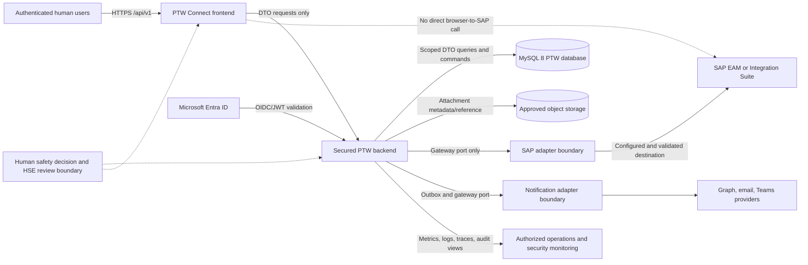

# PTW Connect Phase 1 Architecture

**Status**: Phase 1 design; no runtime implementation
**Source**: `prd.md`, [spec.md](./spec.md), and [plan.md](./plan.md)

## Purpose and Safety Boundary

PTW Connect is an enterprise Permit-to-Work system that supports competent human
decision-making. It MUST NOT autonomously decide that work is safe or automatically
approve, issue, activate, suspend, extend, hand back, or close a permit. The server
must require an authenticated, authorized human command for each safety-critical action.
The UI and documentation must display this limitation.

The design deliberately separates `APPROVED`, `ISSUED`, and `ACTIVE`. Approval does not
activate a permit. Activation requires the configured human acknowledgments and safety
evidence, including risk confirmation, isolation verification, gas-test acknowledgment,
toolbox-talk acknowledgment, valid dates, and any site-required checks.

Approval, issue, activation, suspension, extension, handback, closure, cancellation,
and expiry are all explicit human-controlled lifecycle actions. A server-side command
must record the authenticated actor, authorization scope, reason or comment, current
state, resulting state, and audit outcome for each action; none is inferred from a UI
condition or performed autonomously.

## Actors and Trust Boundaries

- **Permit Requester**: creates and submits a draft within authorized plant/location scope.
- **Performing Authority**: supplies work scope and personnel information.
- **Area Authority / Operations Representative / Site Controller**: perform configured
  operational reviews, issue, control, handover, suspension, or closure actions.
- **HSE Reviewer**: performs configured risk and safety review.
- **Gas Tester and Isolation Authorities**: record and independently verify safety evidence.
- **Permit Issuer and Permit Receiver**: explicitly issue, acknowledge, receive, and
  activate work under configured segregation-of-duties rules.
- **Approver / Auditor / Administrator / Read-Only User**: receive only the authority
  assigned by server-side role and plant/location configuration.
- **Microsoft Entra ID**: authenticates identities; PTW does not store passwords.
- **SAP and notification providers**: external systems reached only through secured
  backend integration ports and adapters.

## Ownership Boundaries

- `frontend/`: accessible responsive user experience; never the authorization boundary.
- `backend/`: REST DTOs, authentication, authorization, workflow guards, audit commands,
  and integration orchestration.
- `database/`: MySQL 8 schema and versioned Flyway migrations; append-only history rules.
- `integration/`: gateway ports, SAP mappings/adapters, notification adapters, and
  sanitized integration errors.
- `deployment/`: local containers, health/readiness, environment configuration, and
  approved deployment assets.
- `docs/`: architecture, security, domain, operations, testing, HSE, and assumptions.
- `.github/`: Copilot instructions and CI checks; production deployment requires a gate.

## Mermaid Architecture View

The dotted browser-to-SAP edge is a prohibition, not a network route. SAP credentials,
tokens, certificates, and confidential payloads remain behind the secured backend or
approved integration layer.

## Safety-Critical Command Boundary

Every command resolves identity, role, plant/location scope, current state, mandatory
data, evidence, segregation of duties, idempotency, and optimistic version on the
server. The server records actor, authenticated identity, server UTC time, old/new state,
comments or reason, source address, correlation ID, idempotency key, outcome, and evidence
references in append-only history.

Site-specific roles, approval routes, risk matrices, gas limits, isolation requirements,
permit types, and validity rules are configuration. Missing or ambiguous safety
configuration denies the action. The canonical SAP fields remain proposed until customer
metadata and connectivity are validated.

## Phase 1 Boundary and Gate

This document is architecture only. It does not create frontend/backend code, database
migrations, Docker/Helm assets, CI behavior, SAP calls, notification delivery, or
production data. Phase 2 scaffolding remains blocked until the Phase 1 review record
contains the required product, architecture, HSE, operations, security, legal/compliance,
and customer SAP decisions.
