# PTW Connect Phase 1 Conceptual Data Model

**Feature**: [spec.md](./spec.md)
**Plan**: [plan.md](./plan.md)
**Status**: Design artifact; not a migration or executable schema
**Related artifacts**: [workflow.md](./workflow.md),
[authorization-contract.md](./contracts/authorization-contract.md), and
[hse-validation-checklist.md](./hse-validation-checklist.md)

## Modeling Rules

- Externally exposed identifiers are UUIDs. Internal numeric keys are not required by
  this design and require explicit justification if introduced later.
- All persisted timestamps are UTC. A plant/site timezone is stored separately for
  display and date interpretation.
- Mutable business records use optimistic versioning where concurrent commands are
  possible. Workflow and audit history are append-only and never hard-deleted.
- Every permit query and state-changing command is scoped by server-resolved plant and
  location authorization.
- Attachments store metadata, validation state, and an object-storage reference; binary
  content is not stored in MySQL.
- Candidate roles, permit types, hazards, controls, gas limits, isolation types, risk
  matrices, and approval routes are configuration, not universal constants.
- The ERD is conceptual. Names and fields are design contracts for later migration
  design, not a claim that every table or column is final.

## Bounded Areas and Entities

### Identity and authorization

- `users`: Entra subject, display identity, active status, contact metadata, and audit
  timestamps. No password fields.
- `roles`: Configurable role catalog seeded with the PRD role names for review only.
- `user_roles`: User-to-role assignments with effective status and audit metadata.
- `user_authorizations`: Plant/location scope and permitted actions, effective dates, and
  status. Lack of a matching authorization is denial.
- `delegations`: Delegator, substitute, effective interval, delegated role/scope, reason,
  and approval/activation status.

### Organization and site master data

- `companies`, `business_units`, `plants`: Organization hierarchy and plant timezone.
- `functional_locations`, `equipment`, `work_centers`: Work location and asset context.
- `permit_types`: Site-configurable form, evidence, role, and risk requirements.
- `hazards`, `controls`: Configurable hazard/control catalog and status.
- `risk_matrix_config`: Versioned likelihood/severity matrix, score rules, and review
  threshold; numeric values require HSE validation.
- `gas_test_limits`: Configurable gas, unit, safe range, warning/blocking rule, and
  retest interval; represented here as a design dependency even if implemented under
  the gas-test master-data area later.
- `isolation_types`: Configurable isolation category and verification requirements.
- `holiday_calendars`, `shift_calendars`: Plant-specific operating and handover rules.
- `approval_matrix`: Configuration for permit type, site, risk, work category, required
  role, sequence/parallel behavior, escalation, delegation, and SOD rules.
- `workflow_definitions`, `workflow_steps`: Versioned transition vocabulary and
  transition requirements.

### Permit and safety evidence

- `permits`: Permit identity, number, status, plant/location, type, validity, risk
  summary, requester, receiver, issuer, SAP reference, version, and lifecycle metadata.
- `permit_activities`: Work scope, method statement, tools, materials, simultaneous
  operations, and activity-specific location/category.
- `contractors`, `permit_workers`: Organization and people associated with work; worker
  attendance and role are controlled data.
- `risk_assessments`: Initial/residual likelihood and severity, scores, human
  confirmation, matrix version, reviewer, and confirmation time.
- `permit_hazards`: Permit-to-hazard relationship with selected controls and evidence.
- `isolations`, `isolation_points`: Isolation plan, tag/lock references, status,
  performer, independent verifier, verification time, evidence, and de-isolation state.
- `gas_tests`, `gas_test_readings`: Test event, location, tester, instrument,
  calibration, test type, readings, configured limit version, acknowledgment, and
  validity/expiry.
- `toolbox_talks`, `toolbox_talk_attendees`: Talk content, hazards/controls presented,
  issuer and receiver acknowledgment, attendees, and confirmation time.
- `attachments`: Safe metadata, object-storage key, content type, size, validation,
  malware-scan status, ownership, and access history reference.

### Workflow, handover, and audit

- `workflow_instances`: Permit-linked versioned workflow execution and current state.
- `workflow_tasks`: Human task, required role/scope, sequence/parallel group, due date,
  delegation, and completion state.
- `workflow_history`: Append-only state/action evidence with old/new state, actor,
  authentication identity, role/scope snapshot, timestamp, comment, source address,
  correlation ID, idempotency key, action, outcome, and sequence.
- `permit_extensions`, `permit_suspensions`: Human requests, reasons, changed dates or
  conditions, reassessment/reapproval requirements, decisions, and evidence.
- `shift_handovers`, `shift_handover_items`: Outgoing/incoming controllers, shift,
  active/suspended permit list, acceptance state, exceptions, and immutable handover
  history.
- `audit_events`: Append-only login, access, controlled-change, attachment,
  configuration, integration, and notification event evidence.
- `idempotency_keys`: Command key, authenticated subject, operation, target, request
  fingerprint, result reference, status, and expiry; replay behavior is explicit.

### Integration and notifications

- `sap_systems`: Approved destination configuration references, never frontend secrets.
- `sap_order_references`: Permit-to-SAP order link, source system, last successful sync,
  stale state, and PTW-controlled field protection.
- `sap_sync_events`: Correlation ID, operation, status, timestamps, retry/dead-letter
  metadata, sanitized error summary, and manual reprocessing state.
- `notifications`, `notification_outbox`: Intended recipient/event, channel, template
  version, delivery state, retry metadata, correlation ID, and sanitized failure detail.

## Permit State Vocabulary and Transition Categories

The initial vocabulary is: `DRAFT`, `SUBMITTED`, `RISK_REVIEW`, `ISOLATION_PENDING`,
`GAS_TEST_PENDING`, `APPROVAL_PENDING`, `APPROVED`, `ISSUED`, `ACTIVE`, `SUSPENDED`,
`EXTENSION_PENDING`, `HANDBACK_PENDING`, `CLOSURE_PENDING`, `CLOSED`, `REJECTED`,
`CANCELLED`, and `EXPIRED`.

The following transition categories are design constraints, not automatic actions:

| Category | Example state movement | Human and evidence boundary |
|---|---|---|
| Draft submission | DRAFT -> SUBMITTED | Requester submits; server validates scope and mandatory data |
| Review and correction | SUBMITTED/RISK_REVIEW -> RISK_REVIEW or REJECTED | Assigned human reviewer; rejection/return requires comment |
| Safety readiness | ISOLATION_PENDING/GAS_TEST_PENDING -> APPROVAL_PENDING | Authorized isolation verifier/gas tester records evidence |
| Approval | APPROVAL_PENDING -> APPROVED or REJECTED | Configured approver acts; SOD and self-approval rules apply |
| Issue | APPROVED -> ISSUED | Permit Issuer explicitly issues after approval; not active |
| Activation | ISSUED -> ACTIVE | Permit Issuer and Receiver complete required human checks |
| Suspension/resumption | ACTIVE -> SUSPENDED -> ACTIVE or controlled next state | Authorized human records reason and validation |
| Extension | ACTIVE -> EXTENSION_PENDING -> ACTIVE/APPROVAL_PENDING | Human requests; risk reassessment and reapproval are configurable |
| Handback/closure | ACTIVE -> HANDBACK_PENDING -> CLOSURE_PENDING -> CLOSED | Receiver hands back; authorized personnel verify closure evidence |
| Cancellation/expiry | Eligible state -> CANCELLED/EXPIRED | Server evaluates dates, but a human command or configured operational process must record the action; no silent safety approval |

Every transition requires current-state validation, authenticated identity, role,
plant/location scope, mandatory data, configured SOD checks, optimistic version check,
idempotency key, server timestamp, and append-only history. Rejection, return, and
suspension require reasons where the PRD requires them.

## Validation Rules

- `permits.status` cannot be client-authoritative; it changes only through an approved
  workflow command.
- A permit cannot activate when required risk confirmation, isolation verification, gas
  test acknowledgment, toolbox-talk acknowledgment, validity, or configured evidence is
  absent, expired, rejected, or performed by an unauthorized person.
- Approval cannot imply activation. `APPROVED` and `ISSUED` remain non-active states.
- A user must have active role and plant/location authorization for the requested action.
- Self-approval and other SOD combinations are denied unless an explicitly configured
  policy permits them; unspecified safety-critical SOD behavior defaults to denial.
- A repeated idempotency key with the same request fingerprint returns the recorded
  result; a conflicting fingerprint is rejected.
- A stale entity/workflow version produces a conflict and does not append a second
  transition.
- Closed permits are immutable. Corrections require a separately authorized amendment
  process that preserves before/after evidence.
- Attachment references require allow-listed type/size/content validation and malware-
  scan status before use in safety decisions.
- SAP refresh may update only fields explicitly allowed by validated mapping; PTW-
  controlled status, approvals, evidence, and audit fields cannot be overwritten.
- Retention and legal hold prevent deletion of protected audit, workflow, and controlled
  evidence records.

## Mermaid ER Diagram

```mermaid
erDiagram
    USERS ||--o{ USER_ROLES : has
    ROLES ||--o{ USER_ROLES : assigned
    USERS ||--o{ USER_AUTHORIZATIONS : receives
    PLANTS ||--o{ USER_AUTHORIZATIONS : scopes
    FUNCTIONAL_LOCATIONS ||--o{ USER_AUTHORIZATIONS : scopes
    USERS ||--o{ DELEGATIONS : delegates
    USERS ||--o{ DELEGATIONS : substitutes

    COMPANIES ||--o{ BUSINESS_UNITS : owns
    BUSINESS_UNITS ||--o{ PLANTS : contains
    PLANTS ||--o{ FUNCTIONAL_LOCATIONS : contains
    PLANTS ||--o{ EQUIPMENT : contains
    PLANTS ||--o{ WORK_CENTERS : contains
    PLANTS ||--o{ PERMIT_TYPES : configures
    PLANTS ||--o{ RISK_MATRIX_CONFIG : configures
    PLANTS ||--o{ GAS_TEST_LIMITS : configures
    PLANTS ||--o{ ISOLATION_TYPES : configures
    PLANTS ||--o{ APPROVAL_MATRIX : configures
    PLANTS ||--o{ SHIFT_CALENDARS : uses
    PLANTS ||--o{ HOLIDAY_CALENDARS : uses

    PERMIT_TYPES ||--o{ PERMITS : classifies
    PLANTS ||--o{ PERMITS : authorizes
    FUNCTIONAL_LOCATIONS ||--o{ PERMITS : locates
    EQUIPMENT ||--o{ PERMITS : references
    USERS ||--o{ PERMITS : requests
    CONTRACTORS ||--o{ PERMIT_WORKERS : supplies
    PERMITS ||--o{ PERMIT_ACTIVITIES : contains
    PERMITS ||--o{ PERMIT_WORKERS : assigns
    PERMITS ||--o{ PERMIT_HAZARDS : identifies
    HAZARDS ||--o{ PERMIT_HAZARDS : selected
    CONTROLS ||--o{ PERMIT_HAZARDS : mitigates
    PERMITS ||--o{ RISK_ASSESSMENTS : assesses
    RISK_MATRIX_CONFIG ||--o{ RISK_ASSESSMENTS : scores
    PERMITS ||--o{ ISOLATIONS : requires
    ISOLATION_TYPES ||--o{ ISOLATIONS : categorizes
    ISOLATIONS ||--o{ ISOLATION_POINTS : contains
    PERMITS ||--o{ GAS_TESTS : requires
    GAS_TESTS ||--o{ GAS_TEST_READINGS : records
    PERMITS ||--o{ TOOLBOX_TALKS : requires
    TOOLBOX_TALKS ||--o{ TOOLBOX_TALK_ATTENDEES : includes
    USERS ||--o{ TOOLBOX_TALK_ATTENDEES : attends
    PERMITS ||--o{ ATTACHMENTS : owns

    WORKFLOW_DEFINITIONS ||--o{ WORKFLOW_STEPS : defines
    PERMIT_TYPES ||--o{ WORKFLOW_DEFINITIONS : selects
    PERMITS ||--|| WORKFLOW_INSTANCES : has
    WORKFLOW_DEFINITIONS ||--o{ WORKFLOW_INSTANCES : instantiates
    WORKFLOW_INSTANCES ||--o{ WORKFLOW_TASKS : creates
    WORKFLOW_INSTANCES ||--o{ WORKFLOW_HISTORY : records
    APPROVAL_MATRIX ||--o{ WORKFLOW_TASKS : routes
    USERS ||--o{ WORKFLOW_TASKS : acts
    PERMITS ||--o{ PERMIT_EXTENSIONS : extends
    PERMITS ||--o{ PERMIT_SUSPENSIONS : suspends
    SHIFT_HANDOVERS ||--o{ SHIFT_HANDOVER_ITEMS : transfers
    PERMITS ||--o{ SHIFT_HANDOVER_ITEMS : transferred

    SAP_SYSTEMS ||--o{ SAP_ORDER_REFERENCES : provides
    PERMITS ||--o{ SAP_ORDER_REFERENCES : links
    SAP_ORDER_REFERENCES ||--o{ SAP_SYNC_EVENTS : synchronizes
    PERMITS ||--o{ NOTIFICATIONS : concerns
    NOTIFICATIONS ||--o{ NOTIFICATION_OUTBOX : queues
    PERMITS ||--o{ AUDIT_EVENTS : audits
    USERS ||--o{ AUDIT_EVENTS : acts
    PERMITS ||--o{ IDEMPOTENCY_KEYS : targets
```

## Required History and Concurrency Boundaries

`workflow_history`, `audit_events`, and completed handover evidence are append-only.
Foreign keys use restrictive deletion semantics for history references. Mutable aggregates
such as `permits`, `workflow_instances`, and configuration records carry a version and
updated-by metadata. Command processing records idempotency before returning a result.
The final physical schema must add indexes from real query patterns, especially permit
status/plant/location, workflow tasks, expiry, audit time, integration status, and
idempotency lookup.
